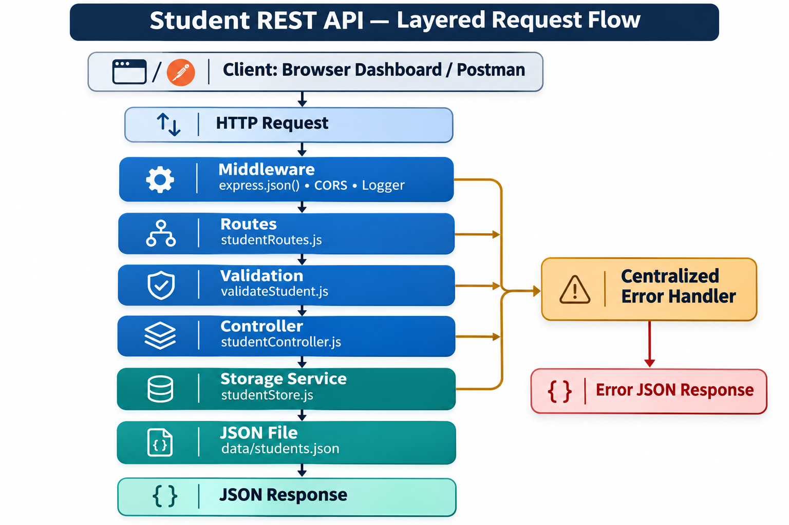
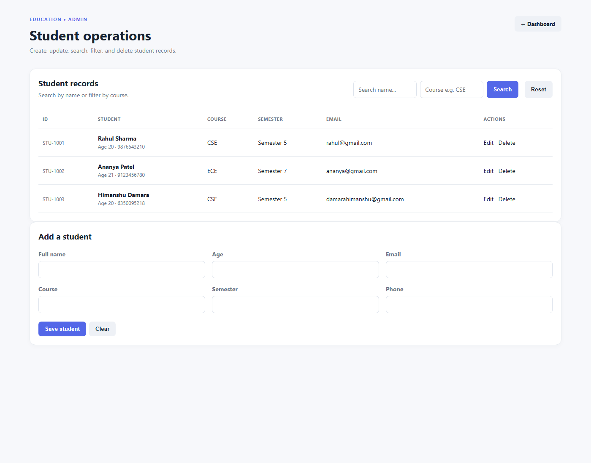
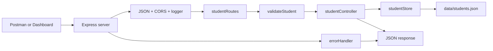
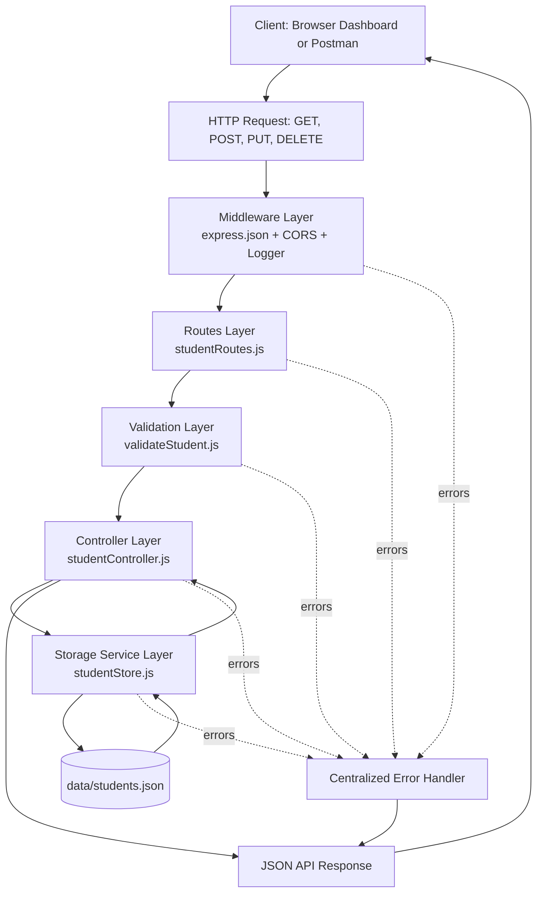

# Student REST API — FSD II Mini Project

## Project details

**Project Title:** Student REST API  
**Domain:** Education  
**Description:** Education REST API for creating, reading, updating, and deleting student records.  
**Development Tools:** Computer, Visual Studio Code, Node.js, and Postman  
**Technologies Used:** Node.js and Express.js  
**Objective:** Implement RESTful CRUD operations with routing and middleware.  
**Expected Outcome:** Students will be able to develop, run, test, and demonstrate a complete REST API for managing student records using Node.js and Express.js.

## Project overview

A simple, beginner-friendly Express.js REST API for managing student records. The project uses a local JSON file for persistence and includes an optional browser dashboard for demonstrating CRUD operations.

**Domain:** Education  
**Technologies:** Node.js, Express.js, HTML, CSS, vanilla JavaScript  
**Storage:** `data/students.json`

## Objectives

- Implement RESTful CRUD operations.
- Use Express routes and middleware.
- Validate student input.
- Prevent duplicate email addresses.
- Store records persistently in a JSON file.
- Support name search and course filtering.
- Test the API with Postman.

## Features

- Add a student.
- View all students.
- View one student by ID.
- Edit a student.
- Delete a student.
- Search by name.
- Filter by course.
- Request logging.
- Email, age, semester, and phone validation.
- Centralized error handling.
- Simple responsive dashboard.

## Folder structure

```text
student-rest-api/
├── controllers/studentController.js
├── controllers/statsController.js
├── data/students.json
├── middleware/
│   ├── errorHandler.js
│   ├── logger.js
│   └── validateStudent.js
├── postman/Student-REST-API.postman_collection.json
├── public/
│   ├── auth.css                   # Login and logout styling
│   ├── auth.js                    # Demo session guard
│   ├── app.js                     # Student operations page logic
│   ├── dashboard.js               # Dashboard page logic
│   ├── index.html                 # Dashboard page
│   ├── login.html                 # Login page
│   ├── login.js                   # Login form behavior
│   ├── students.html              # Student operations page
│   └── styles.css
├── routes/studentRoutes.js
├── services/studentStore.js
├── .env.example
├── package.json
├── README.md
└── server.js
```

## Prerequisites

- Node.js 18 or newer.
- npm.
- VS Code or another code editor.
- Postman for API testing.

Check installation:

```bash
node --version
npm --version
```

## Installation and running

```bash
cd "C:\Users\HP\OneDrive\Desktop\full"
npm install
```

Create the environment file:

```powershell
Copy-Item .env.example .env
```

Start the server:

```bash
npm start
```

For development:

```bash
npm run dev
```

Open the dashboard at `http://localhost:3000`.

The application opens with a demo login page. Use:

```text
Username: admin
Password: admin123
```

After login, the dashboard and student operations pages are protected by a browser session. Use the **Logout** button to return to the login page. This is demo authentication for the academic project; production authentication should use a backend user database, hashed passwords, and secure tokens.

Open student operations at `http://localhost:3000/students.html`.

The API base URL is `http://localhost:3000/api`.

## Environment variables

`.env.example` contains:

```env
PORT=3000
NODE_ENV=development
```

## Student data model

| Field | Type | Rules |
|---|---|---|
| `id` | String | Unique sequential ID such as `STU-1001` |
| `fullName` | String | Required, minimum 2 characters |
| `age` | Number | Integer from 15 to 100 |
| `email` | String | Required, valid, and unique |
| `course` | String | Required |
| `semester` | Number | Integer from 1 to 8 |
| `phone` | String | Valid phone number |
| `createdAt` | ISO date | Generated automatically |
| `updatedAt` | ISO date | Updated automatically |

Example request body:

```json
{
  "fullName": "Priya Singh",
  "age": 20,
  "email": "priya.singh@example.com",
  "course": "CSE",
  "semester": 5,
  "phone": "9988776655"
}
```

## API endpoints

| Method | Endpoint | Purpose | Status |
|---|---|---|---|
| GET | `/api/health` | Check API status | 200 |
| GET | `/api/stats` | Get dashboard statistics | 200 |
| GET | `/api/students` | Get all students | 200 |
| GET | `/api/students/:id` | Get one student | 200 |
| POST | `/api/students` | Create a student | 201 |
| PUT | `/api/students/:id` | Update a student | 200 |
| DELETE | `/api/students/:id` | Delete a student | 200 |

### Search and filter

```http
GET /api/students?search=rahul
GET /api/students?course=CSE
```

Search matches the student full name without case sensitivity. Course filtering matches the complete course value.

### Health check

```http
GET /api/health
```

### Dashboard statistics

```http
GET /api/stats
```

This endpoint returns the total number of students, total courses, course counts, semester counts, and the latest student record for dashboard summaries.

Response:

```json
{
  "success": true,
  "message": "Student API is running",
  "timestamp": "2026-11-01T12:00:00.000Z"
}
```

### Successful response format

```json
{
  "success": true,
  "message": "Student created successfully",
  "data": {
    "id": "STU-1003",
    "fullName": "Priya Singh",
    "age": 20,
    "email": "priya.singh@example.com",
    "course": "CSE",
    "semester": 5,
    "phone": "9988776655",
    "createdAt": "2026-11-01T12:00:00.000Z",
    "updatedAt": "2026-11-01T12:00:00.000Z"
  }
}
```

## HTTP status codes

| Code | Meaning |
|---|---|
| 200 | Successful read, update, or delete |
| 201 | Student created successfully |
| 400 | Validation error, duplicate email, malformed JSON, or invalid ID format |
| 404 | Student or route not found |
| 500 | Unexpected server error |

Example validation response:

```json
{
  "success": false,
  "message": "Validation failed",
  "errors": ["email must be valid"]
}
```

## Middleware

- `express.json()` parses JSON request bodies.
- `cors()` allows local browser clients to call the API.
- `logger.js` prints the method, URL, response status, and response time.
- `validateStudent.js` checks incoming student data.
- `errorHandler.js` returns consistent error responses.

## Architecture and data flow

## Project screenshots and diagrams

### Layered request flow



This diagram shows how a request moves from the dashboard or Postman through Express middleware, routes, validation, controllers, the storage service, and `data/students.json`, before returning a JSON response.

### Screenshots to add during demonstration

For the final academic report, add these screenshots to `docs/screenshots/` after running the project:

1. `login-page.png` — Login screen with the demo credentials.
2. `dashboard.png` — Dashboard showing student totals and recent records.
3. `student-operations.png` — Student list and add-student form.
4. `postman-run-results.png` — Postman collection run showing the request results.
5. `validation-error.png` — Postman validation response with the errors array.

Use this Markdown format when adding them:

```markdown



```



1. The client sends an HTTP request.
2. Express parses and logs it.
3. The router selects the student endpoint.
4. POST and PUT data pass validation.
5. The controller performs the CRUD operation.
6. The storage service reads or safely writes the JSON file.
7. The API returns a JSON response.

### Layered request flow diagram



### Layer responsibilities

| Layer | Responsibility |
|---|---|
| Client | Sends requests through the dashboard or Postman |
| Middleware | Parses JSON, enables CORS, and logs requests |
| Routes | Matches the URL and HTTP method |
| Validation | Checks required fields and valid values |
| Controller | Executes CRUD and search/filter logic |
| Storage service | Reads and safely writes student records |
| JSON file | Stores student data permanently |
| Error handler | Returns consistent error responses |

## Dashboard and student operations usage

1. Start the server.
2. Open `http://localhost:3000`.
3. Review total students, courses, and the latest update on the dashboard.
4. Click **Open Student Operations**.
5. Use the student operations page to add a student.
6. Click **Edit** to load a record into the form.
7. Click **Delete** and confirm the action.
8. Use the search and course fields to find records.
9. Use **Reset** to clear filters.
10. Return to the dashboard with the **Dashboard** link.

## Postman testing

Import:

```text
postman/Student-REST-API.postman_collection.json
```

The collection includes health, CRUD, search, filter, missing-field, invalid-email, duplicate-email, invalid-ID, and nonexistent-ID requests.

Recommended order:

1. Health check.
2. Get all students.
3. Create student.
4. Copy the returned ID into the `studentId` variable.
5. Get by ID.
6. Update student.
7. Search and filter.
8. Delete student.
9. Run negative test cases.

## Test cases

| Test | Expected result |
|---|---|
| Valid POST | 201 and generated student ID |
| Missing field | 400 with errors array |
| Invalid email | 400 |
| Duplicate email | 400 |
| Invalid age or semester | 400 |
| Existing ID | 200 |
| Unknown ID | 404 |
| Invalid ID format | 400 |
| Unknown route | 404 |
| Malformed JSON | 400 |

## Viva questions

**What is REST?** REST is a design style where resources are represented by URLs and HTTP methods describe operations.

**Why use Express?** Express provides simple routing, middleware, request handling, and response handling on top of Node.js.

**What is middleware?** Middleware is a function that runs during the request-response cycle for tasks such as logging, parsing, validation, or errors.

**Why use JSON storage?** JSON storage is simple, persistent, and suitable for this small academic project. A production system would normally use a database.

**Why return 201 for POST?** HTTP 201 means a new resource was created successfully.

**How are duplicate emails prevented?** The controller compares normalized lowercase email values before creating or updating a record.

**What does CORS do?** CORS allows a browser client to call the API when the server permits that origin.

## Limitations and future enhancements

The project does not include authentication, role-based access, a production database, or automated test suites. Future versions could add MongoDB/PostgreSQL, JWT login, attendance, marks, pagination, reporting, rate limiting, and deployment.

## Academic submission checklist

- [ ] Run `npm install`.
- [ ] Create `.env` from `.env.example`.
- [ ] Start the server with `npm start`.
- [ ] Demonstrate the dashboard.
- [ ] Demonstrate CRUD operations in Postman.
- [ ] Demonstrate validation and negative cases.
- [ ] Include this README with the project.

## Conclusion

This project demonstrates Node.js, Express.js, RESTful CRUD operations, routing, middleware, validation, persistent JSON storage, and API testing in a simple form suitable for an FSD II lab mini-project.

## License

For educational and academic use.
